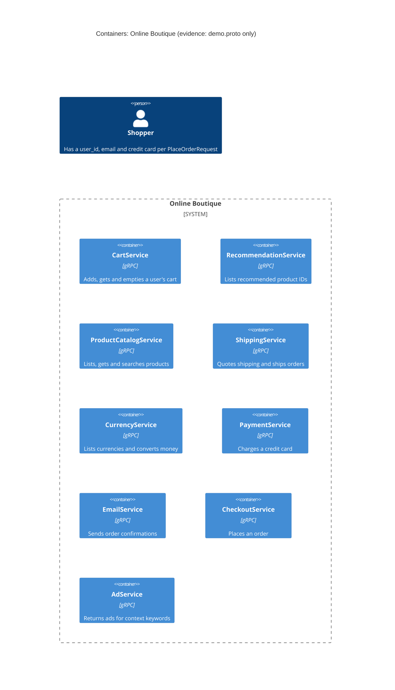

# Task 1, run A: Recovered container architecture (Online Boutique)

## 1. Agent

- Product: Claude Code (VS Code extension)
- Model: Claude Opus 5.5 (`claude-opus-5-5`)

## 2. Files read

- `prompts/1-recover-architecture.md` (task file)
- `system/online-boutique/protos/demo.proto` (the only evidence)

## 3. Containers table

The proto file defines nine gRPC services in package `hipstershop` (`demo.proto` line 17). It does not show implementation languages, deployment names or data stores.

| Container | Technology / language | Responsibility | Evidence |
|---|---|---|---|
| CartService | gRPC (proto3). Language: Not evidenced in the provided files | Add items to a user's cart, get the cart, empty the cart (`AddItem`, `GetCart`, `EmptyCart`) | `system/online-boutique/protos/demo.proto` lines 23-27 (`service CartService`) |
| RecommendationService | gRPC (proto3). Language: Not evidenced | Return recommended product IDs for a user and a list of products (`ListRecommendations`) | `system/online-boutique/protos/demo.proto` lines 56-58 (`service RecommendationService`) |
| ProductCatalogService | gRPC (proto3). Language: Not evidenced | List, get and search products (`ListProducts`, `GetProduct`, `SearchProducts`) | `system/online-boutique/protos/demo.proto` lines 71-75 (`service ProductCatalogService`) |
| ShippingService | gRPC (proto3). Language: Not evidenced | Quote shipping cost and ship an order, returning a tracking ID (`GetQuote`, `ShipOrder`) | `system/online-boutique/protos/demo.proto` lines 107-110 (`service ShippingService`) |
| CurrencyService | gRPC (proto3). Language: Not evidenced | List supported currencies and convert money between currencies (`GetSupportedCurrencies`, `Convert`) | `system/online-boutique/protos/demo.proto` lines 140-143 (`service CurrencyService`) |
| PaymentService | gRPC (proto3). Language: Not evidenced | Charge a credit card and return a transaction ID (`Charge`) | `system/online-boutique/protos/demo.proto` lines 177-179 (`service PaymentService`) |
| EmailService | gRPC (proto3). Language: Not evidenced | Send an order confirmation to an email address (`SendOrderConfirmation`) | `system/online-boutique/protos/demo.proto` lines 199-201 (`service EmailService`) |
| CheckoutService | gRPC (proto3). Language: Not evidenced | Place an order and return the order result (`PlaceOrder`) | `system/online-boutique/protos/demo.proto` lines 224-226 (`service CheckoutService`) |
| AdService | gRPC (proto3). Language: Not evidenced | Return text ads for page context keywords (`GetAds`) | `system/online-boutique/protos/demo.proto` lines 243-245 (`service AdService`) |

Data stores: Not evidenced in the provided files.

End user (shown as `Person` in the diagram): the proto carries user data (`user_id`, `email`, `CreditCardInfo` in `PlaceOrderRequest`, lines 228-235), so a shopper exists as a concept. How the shopper reaches the system is Not evidenced.

## 4. Dependencies table

| Caller → callee | Protocol | Evidence |
|---|---|---|
| (none) | - | Not evidenced in the provided files. `demo.proto` declares which RPCs each service **offers**. It does not say which service **calls** which. |

## 5. Mermaid diagram

The diagram has no `Rel` lines because the Dependencies table has no rows. Inferred dependencies are listed under **Gaps**.

## 6. Gaps

| Gap | Why it is a gap | File that would settle it |
|---|---|---|
| Who calls whom (all runtime dependencies) | The proto lists server interfaces only, not clients | `system/online-boutique/kubernetes-manifests/*.yaml` (`*_SERVICE_ADDR` environment variables, e.g. `frontend.yaml (CART_SERVICE_ADDR)`) or each service's client code |
| **[Inferred]** CheckoutService calls CartService, ProductCatalogService, CurrencyService, ShippingService, PaymentService and EmailService | `PlaceOrderRequest` (lines 228-235) carries `user_id`, `user_currency`, `address`, `email` and `credit_card`, and `PlaceOrderResponse` returns an `OrderResult` with `shipping_tracking_id` and `shipping_cost` (lines 208-214). These match the inputs and outputs of those six services, but the proto does not prove the calls | `checkoutservice` source and its Kubernetes manifest |
| **[Inferred]** RecommendationService calls ProductCatalogService | `ListRecommendationsResponse` returns `product_ids` (lines 65-67), which could come from the catalog. Not proved | `recommendationservice` source and manifest |
| Web front end / entry point for the shopper | No front-end service is defined in the proto, and no HTTP interface is shown | `system/online-boutique/kubernetes-manifests/frontend.yaml` and the front-end source |
| Data stores (e.g. where carts and products are stored) | `Cart` (lines 47-50) implies state, but no storage is named | CartService and ProductCatalogService source or manifests |
| Implementation language of each service | Only `option go_package` (line 19) is present, which configures Go code generation. It does not show that every service is written in Go | Each service's source folder or Dockerfile |
| External systems (real payment provider, mail server) | `Charge` and `SendOrderConfirmation` might call outside systems, but the proto does not show it | PaymentService and EmailService source |
| Transport security for card data | `CreditCardInfo` (lines 181-186) sends the full card number and CVV in `PlaceOrderRequest` and `ChargeRequest`. Whether gRPC traffic uses TLS is Not evidenced. This is a security risk to check | Kubernetes manifests (or service mesh config) and server/client setup in source |
