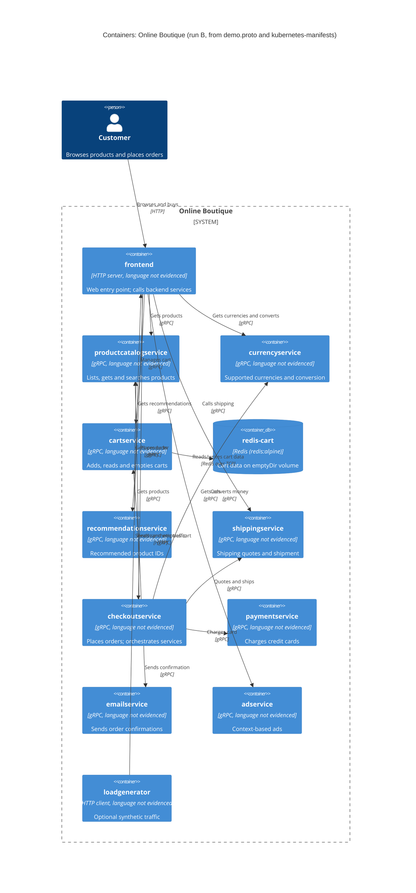

# Task 1 (run B): Recovered C4 container architecture of Online Boutique

Evidence allowed: `system/online-boutique/protos/demo.proto`, `system/online-boutique/kubernetes-manifests/`

## 1. Agent

- Product: Claude Code (VS Code extension)
- Model: Claude Opus 5.5 (`claude-opus-5-5`)

## 2. Files read

Evidence files:

- `system/online-boutique/protos/demo.proto`
- `system/online-boutique/kubernetes-manifests/README.md`
- `system/online-boutique/kubernetes-manifests/kustomization.yaml`
- `system/online-boutique/kubernetes-manifests/adservice.yaml`
- `system/online-boutique/kubernetes-manifests/cartservice.yaml`
- `system/online-boutique/kubernetes-manifests/checkoutservice.yaml`
- `system/online-boutique/kubernetes-manifests/currencyservice.yaml`
- `system/online-boutique/kubernetes-manifests/emailservice.yaml`
- `system/online-boutique/kubernetes-manifests/frontend.yaml`
- `system/online-boutique/kubernetes-manifests/loadgenerator.yaml`
- `system/online-boutique/kubernetes-manifests/paymentservice.yaml`
- `system/online-boutique/kubernetes-manifests/productcatalogservice.yaml`
- `system/online-boutique/kubernetes-manifests/recommendationservice.yaml`
- `system/online-boutique/kubernetes-manifests/shippingservice.yaml`

Instruction files (not evidence): `prompts/1-recover-architecture.md`, `AGENTS.md` (loaded via `CLAUDE.md`). The folder `kubernetes-manifests/` was listed to find its files.

## 3. Containers table

Implementation language is not visible in any allowed file: every `image:` is a bare name (e.g. `image: frontend`), and the README says real tags are inserted by `skaffold`. The only concrete image is `redis:alpine`.

| Container | Technology / language | Responsibility | Evidence |
|---|---|---|---|
| `frontend` | HTTP server, port 8080; language not evidenced | Web entry point for shoppers; calls the backend services. Exposed outside the cluster through a `LoadBalancer` | `kubernetes-manifests/frontend.yaml` (Deployment `frontend`, `httpGet /_healthz`, Service `frontend-external` type `LoadBalancer`, port name `http`) |
| `productcatalogservice` | gRPC server, port 3550; language not evidenced | Lists, gets and searches products (`ListProducts`, `GetProduct`, `SearchProducts`) | `protos/demo.proto` (`service ProductCatalogService`); `kubernetes-manifests/productcatalogservice.yaml` (port name `grpc`, `grpc` probes) |
| `currencyservice` | gRPC server, port 7000; language not evidenced | Lists supported currencies and converts money (`GetSupportedCurrencies`, `Convert`) | `protos/demo.proto` (`service CurrencyService`); `kubernetes-manifests/currencyservice.yaml` (port name `grpc`) |
| `cartservice` | gRPC server, port 7070; language not evidenced | Adds items to, reads and empties a user's cart (`AddItem`, `GetCart`, `EmptyCart`) | `protos/demo.proto` (`service CartService`); `kubernetes-manifests/cartservice.yaml` (port name `grpc`, `REDIS_ADDR`) |
| `redis-cart` | Redis (`redis:alpine`), port 6379 | Stores cart data for `cartservice`. Data is on an `emptyDir` volume, so it does not survive pod rescheduling | `kubernetes-manifests/cartservice.yaml` (Deployment `redis-cart`, `image: redis:alpine`, volume `redis-data: emptyDir`) |
| `recommendationservice` | gRPC server, port 8080; language not evidenced | Returns recommended product IDs (`ListRecommendations`) | `protos/demo.proto` (`service RecommendationService`); `kubernetes-manifests/recommendationservice.yaml` (port name `grpc`) |
| `shippingservice` | gRPC server, port 50051; language not evidenced | Quotes shipping cost and ships orders, returning a tracking ID (`GetQuote`, `ShipOrder`) | `protos/demo.proto` (`service ShippingService`); `kubernetes-manifests/shippingservice.yaml` (port name `grpc`) |
| `checkoutservice` | gRPC server, port 5050; language not evidenced | Places an order (`PlaceOrder`) and returns an `OrderResult`; orchestrates the other services | `protos/demo.proto` (`service CheckoutService`, `PlaceOrderRequest`); `kubernetes-manifests/checkoutservice.yaml` (port name `grpc`, six `*_ADDR` env vars) |
| `paymentservice` | gRPC server, port 50051; language not evidenced | Charges a credit card and returns a transaction ID (`Charge`) | `protos/demo.proto` (`service PaymentService`, `CreditCardInfo`); `kubernetes-manifests/paymentservice.yaml` (port name `grpc`) |
| `emailservice` | gRPC server, Service port 5000 to container port 8080; language not evidenced | Sends order confirmations (`SendOrderConfirmation`) | `protos/demo.proto` (`service EmailService`); `kubernetes-manifests/emailservice.yaml` (Service `port: 5000`, `targetPort: 8080`) |
| `adservice` | gRPC server, port 9555; language not evidenced | Returns ads for context keywords (`GetAds`) | `protos/demo.proto` (`service AdService`); `kubernetes-manifests/adservice.yaml` (port name `grpc`) |
| `loadgenerator` | HTTP client; language not evidenced | Generates synthetic shopper traffic (`USERS=10`, `RATE=1`). Optional: commented out in `kustomization.yaml` | `kubernetes-manifests/loadgenerator.yaml` (Deployment `loadgenerator`); `kubernetes-manifests/kustomization.yaml` (`# - loadgenerator.yaml`) |

## 4. Dependencies table

Protocol evidence for gRPC rows: the callee's Kubernetes Service port is named `grpc`, its probes use `grpc:`, and its interface is a `service` in `demo.proto`. The caller-side evidence is the `*_ADDR` environment variable.

| # | Caller → callee | Protocol | Evidence (file and symbol / env var) |
|---|---|---|---|
| 1 | Customer → `frontend` | HTTP | `kubernetes-manifests/frontend.yaml` (Service `frontend-external`, `type: LoadBalancer`, port name `http`, 80 to 8080) |
| 2 | `loadgenerator` → `frontend` | HTTP | `kubernetes-manifests/loadgenerator.yaml` (`FRONTEND_ADDR=frontend:80`; init container `wget http://${FRONTEND_ADDR}`) |
| 3 | `frontend` → `productcatalogservice` | gRPC | `kubernetes-manifests/frontend.yaml` (`PRODUCT_CATALOG_SERVICE_ADDR=productcatalogservice:3550`) |
| 4 | `frontend` → `currencyservice` | gRPC | `kubernetes-manifests/frontend.yaml` (`CURRENCY_SERVICE_ADDR=currencyservice:7000`) |
| 5 | `frontend` → `cartservice` | gRPC | `kubernetes-manifests/frontend.yaml` (`CART_SERVICE_ADDR=cartservice:7070`) |
| 6 | `frontend` → `recommendationservice` | gRPC | `kubernetes-manifests/frontend.yaml` (`RECOMMENDATION_SERVICE_ADDR=recommendationservice:8080`) |
| 7 | `frontend` → `shippingservice` | gRPC | `kubernetes-manifests/frontend.yaml` (`SHIPPING_SERVICE_ADDR=shippingservice:50051`) |
| 8 | `frontend` → `checkoutservice` | gRPC | `kubernetes-manifests/frontend.yaml` (`CHECKOUT_SERVICE_ADDR=checkoutservice:5050`) |
| 9 | `frontend` → `adservice` | gRPC | `kubernetes-manifests/frontend.yaml` (`AD_SERVICE_ADDR=adservice:9555`) |
| 10 | `checkoutservice` → `productcatalogservice` | gRPC | `kubernetes-manifests/checkoutservice.yaml` (`PRODUCT_CATALOG_SERVICE_ADDR=productcatalogservice:3550`) |
| 11 | `checkoutservice` → `shippingservice` | gRPC | `kubernetes-manifests/checkoutservice.yaml` (`SHIPPING_SERVICE_ADDR=shippingservice:50051`) |
| 12 | `checkoutservice` → `paymentservice` | gRPC | `kubernetes-manifests/checkoutservice.yaml` (`PAYMENT_SERVICE_ADDR=paymentservice:50051`) |
| 13 | `checkoutservice` → `emailservice` | gRPC | `kubernetes-manifests/checkoutservice.yaml` (`EMAIL_SERVICE_ADDR=emailservice:5000`) |
| 14 | `checkoutservice` → `currencyservice` | gRPC | `kubernetes-manifests/checkoutservice.yaml` (`CURRENCY_SERVICE_ADDR=currencyservice:7000`) |
| 15 | `checkoutservice` → `cartservice` | gRPC | `kubernetes-manifests/checkoutservice.yaml` (`CART_SERVICE_ADDR=cartservice:7070`) |
| 16 | `recommendationservice` → `productcatalogservice` | gRPC | `kubernetes-manifests/recommendationservice.yaml` (`PRODUCT_CATALOG_SERVICE_ADDR=productcatalogservice:3550`) |
| 17 | `cartservice` → `redis-cart` | Redis protocol over TCP | `kubernetes-manifests/cartservice.yaml` (`REDIS_ADDR=redis-cart:6379`; Service `redis-cart` port name `tcp-redis`) |

No outgoing `*_ADDR` variables are configured for `productcatalogservice`, `currencyservice`, `shippingservice`, `paymentservice`, `emailservice` or `adservice`, so they have no evidenced downstream dependencies.

## 5. Mermaid diagram

Rel labels describe the callee's interface in `demo.proto`. Which RPCs each caller actually invokes is not evidenced (see Gaps).

## 6. Gaps

| Gap | What the evidence shows | File that would settle it |
|---|---|---|
| Implementation language and framework of every service | Images are bare names (`image: frontend`); README says `skaffold` inserts real tags | Each service's source folder and `Dockerfile` under `system/online-boutique/src/<service>/`; `skaffold.yaml` |
| `shoppingassistantservice` | `frontend.yaml` sets `SHOPPING_ASSISTANT_SERVICE_ADDR=shoppingassistantservice:80`, but no manifest deploys it, `ENABLE_ASSISTANT` is commented out, and `kustomization.yaml` has `# - ../kustomize/components/shopping-assistant`. Not added to the diagram | `system/online-boutique/kustomize/components/shopping-assistant/`; frontend source |
| Which RPCs each caller uses (e.g. whether `frontend` calls `ShippingService.GetQuote` only, or `checkoutservice` calls `CartService.EmptyCart`) | Only addresses are configured; `demo.proto` defines the callee interfaces, not the callers | Frontend and checkout source (`src/frontend/`, `src/checkoutservice/`) |
| Real payment provider or card processor behind `paymentservice` | No outgoing address or credential in `paymentservice.yaml`. **[Inferred]** it may be a mock | `src/paymentservice/` source |
| Real mail server (SMTP or email API) behind `emailservice` | No outgoing address in `emailservice.yaml` | `src/emailservice/` source |
| Where `productcatalogservice` gets its product data | No database or volume in `productcatalogservice.yaml` | `src/productcatalogservice/` source; `kustomize/components/alloydb/`, `kustomize/components/spanner/` |
| Where `recommendationservice`, `currencyservice` and `adservice` get their data | No data store configured | Each service's source |
| Optional external systems | Commented out only: `PACKAGING_SERVICE_URL` (frontend), Google Cloud components (`google-cloud-operations`, `memorystore`, `alloydb`, `spanner`), profiler flags (`ENABLE_PROFILER`, `DISABLE_PROFILER`). None added to the diagram | `system/online-boutique/kustomize/components/` |
| Transport security between services | Addresses carry no scheme or TLS settings. `PlaceOrderRequest` and `ChargeRequest` carry `CreditCardInfo` (card number, CVV). Encryption in transit is not evidenced, which is a security risk to check | Service source (gRPC client/server setup); `kustomize/components/network-policies/`; any Istio config (the pods carry `sidecar.istio.io/rewriteAppHTTPProbers`) |
| Whether `loadgenerator` belongs inside the system boundary | It is a Deployment in the manifests, so it is modelled as a `Container`, but it is commented out in `kustomization.yaml` and only simulates users | Deployment docs or `skaffold.yaml` |
| How the customer reaches `frontend` in production (ingress, CDN, TLS) | Only a plain `LoadBalancer` Service on port 80 (`frontend-external`) | `system/online-boutique/release/` manifests; ingress or Istio configs |
