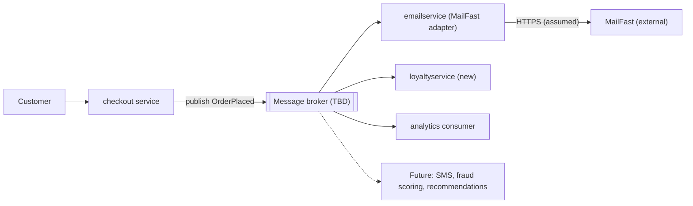

Agent: Claude Code (Anthropic), model: Claude Opus 5.5 (`claude-opus-5-5`)

# ADR-0002: แยกงานหลังสั่งซื้อออกเป็น event-driven consumers ผ่าน `OrderPlaced` event

- **Status:** Proposed
- **Date:** 2026-10-22
- **Deciders:** ไม่ระบุใน requirement (ดู Open questions)

## Context and problem

หลังจากลูกค้าสั่งซื้อสำเร็จ Online Boutique ต้องทำงานเพิ่มสามอย่าง ตาม requirement:

| # | งานหลังสั่งซื้อ | ลักษณะ |
|---|---|---|
| 1 | ส่งอีเมลยืนยันคำสั่งซื้อผ่าน MailFast | external email provider รายใหม่ ใช้แทน logic จำลอง (mock) ใน `emailservice` |
| 2 | ให้ loyalty points | ผ่าน `loyaltyservice` ซึ่งยังต้องสร้างใหม่ |
| 3 | บันทึก analytics event "order placed" | สำหรับทีม marketing |

นอกจากนี้ marketing คาดว่าปีหน้าจะมีงานหลังสั่งซื้อเพิ่มอีก (SMS, fraud scoring, การอัปเดต recommendations) ดังนั้นจำนวนงานที่ต้องทำหลังสั่งซื้อจะเพิ่มขึ้นเรื่อย ๆ ไม่ได้หยุดอยู่ที่สามงาน

ปัญหาที่ต้องตัดสินใจคือ **จะเชื่อมขั้นตอน "สั่งซื้อสำเร็จ" เข้ากับงานหลังสั่งซื้อเหล่านี้อย่างไร** โดยที่การสั่งซื้อยังเร็วและพร้อมใช้งาน แม้ MailFast หรือ service ใหม่จะล่ม และการเพิ่มงานใหม่ในอนาคตไม่ต้องแก้ flow การสั่งซื้อทุกครั้ง

ข้อจำกัดของ ADR นี้:

- ADR นี้เขียนจาก requirement อย่างเดียว ไม่ได้อ่าน source code หรือ manifest ของระบบ ดังนั้นรายละเอียดของระบบปัจจุบันจึงไม่ได้มีหลักฐานรองรับ
- **[Inferred]** service ที่ทำ checkout (สมมติว่าเป็น `checkoutservice`) เป็นผู้เรียก `emailservice` แบบ synchronous หลังสั่งซื้อ ข้อนี้ต้องยืนยันกับ code จริง
- ตัวเลขด้าน performance (latency target, จำนวนคำสั่งซื้อต่อวินาที) และ SLA ของ MailFast ไม่ได้ระบุไว้ (ดู Open questions)

## Decision drivers

เรียงจากสำคัญที่สุด:

1. **Availability ของการสั่งซื้อ:** การสั่งซื้อต้องสำเร็จได้ แม้ MailFast, `loyaltyservice` หรือระบบ analytics จะล่มหรือช้า เพราะ MailFast เป็นระบบภายนอกที่เราควบคุมไม่ได้
2. **Modifiability / extensibility:** ต้องเพิ่มงานหลังสั่งซื้อใหม่ (SMS, fraud scoring, recommendations) ได้โดยไม่ต้องแก้ service ที่ทำ checkout ทุกครั้ง
3. **Performance (checkout latency):** การเพิ่มงานหลังสั่งซื้อไม่ควรทำให้ลูกค้ารอนานขึ้น
4. **Reliability ของงานแต่ละอย่าง:** อีเมลและ loyalty points ต้องไม่หายไปเงียบ ๆ และต้องไม่ให้ points ซ้ำ
5. **Cost และ operational complexity:** ไม่เพิ่ม infrastructure หรือภาระการดูแลมากเกินความจำเป็น
6. **Security / privacy:** ข้อมูลส่วนบุคคล (อีเมลลูกค้า) และ API key ของ MailFast ต้องถูกจัดการอย่างปลอดภัย

## Considered options

1. **Option A: Synchronous orchestration ใน checkout** — service ที่ทำ checkout เรียก `emailservice` (ที่เปลี่ยนไปใช้ MailFast), `loyaltyservice` และ analytics ทีละตัวแบบ synchronous (เช่น gRPC) ก่อนตอบกลับลูกค้า
2. **Option B: Event-driven publish/subscribe** — checkout publish event `OrderPlaced` เพียงครั้งเดียวไปที่ message broker แล้วให้ `emailservice` (MailFast adapter), `loyaltyservice` และ analytics consumer subscribe แยกกันอย่างอิสระ
3. **Option C: Post-order orchestrator service** — สร้าง service ใหม่ (เช่น `postorderservice`) ที่ checkout เรียกครั้งเดียวแบบ asynchronous แล้ว orchestrator เป็นผู้เรียกงานหลังสั่งซื้อทุกอย่างตามลำดับ พร้อม retry ในตัว

### Pros and cons of the options

| Option | Pros | Cons |
|---|---|---|
| A: Synchronous orchestration | เข้าใจง่าย debug ง่ายเพราะเห็น flow ในที่เดียว; ไม่ต้องเพิ่ม infrastructure ใหม่; รู้ผลทันทีว่างานแต่ละอย่างสำเร็จหรือไม่ | checkout latency เพิ่มตามจำนวนงาน (รวม latency ของ MailFast ซึ่งเป็น external); ถ้า MailFast หรือ `loyaltyservice` ล่ม การสั่งซื้ออาจล้มตาม (availability ลดลง); ทุกงานใหม่ในปีหน้าต้องแก้และ deploy checkout ใหม่ (coupling สูง); ต้องตัดสินใจเองว่างานไหนล้มแล้วให้ checkout ล้มด้วยหรือไม่ |
| B: Event-driven pub/sub | checkout ไม่ต้องรู้จัก consumer ใด ๆ การเพิ่ม SMS หรือ fraud scoring ทำได้ด้วยการเพิ่ม subscriber ใหม่ (modifiability สูง); MailFast ล่มก็ไม่กระทบการสั่งซื้อ เพราะ broker เก็บ event ไว้ให้ retry ภายหลัง; checkout latency เพิ่มแค่การ publish ครั้งเดียว; consumer แต่ละตัว scale และ deploy แยกกันได้ | ต้องเพิ่มและดูแล message broker (cost, operational complexity); เป็น eventual consistency ลูกค้าอาจได้อีเมลหรือ points ช้ากว่าการสั่งซื้อเล็กน้อย; การส่งแบบ at-least-once ทำให้ consumer ต้อง idempotent (กันอีเมลหรือ points ซ้ำ); trace ข้าม service ยากขึ้น ต้องมี observability ที่ดี; ต้องแก้ปัญหา "สั่งซื้อสำเร็จแต่ publish event ไม่สำเร็จ" |
| C: Post-order orchestrator | checkout ตอบลูกค้าได้เร็ว เพราะเรียก orchestrator ครั้งเดียว; logic หลังสั่งซื้อรวมอยู่ที่เดียว เห็นลำดับงานชัด; ควบคุมลำดับและการ compensate ได้ง่ายถ้าในอนาคตงานบางอย่างต้องพึ่งกัน (เช่น fraud scoring ก่อนให้ points) | orchestrator กลายเป็นจุดศูนย์รวมใหม่ ทุกงานใหม่ยังต้องแก้ orchestrator (ย้าย coupling มาจาก checkout แต่ไม่ได้ลด); ถ้าไม่มี broker หรือที่เก็บสถานะ งานที่ค้างอยู่ใน orchestrator จะหายเมื่อ pod restart; orchestrator เป็น single point of failure ของงานหลังสั่งซื้อทั้งหมด; ต้องสร้างและดูแล service เพิ่มอีกหนึ่งตัว |

## Decision

เลือก **Option B: Event-driven publish/subscribe** ด้วยเหตุผลดังนี้:

- **ตอบ driver 1 (availability):** การสั่งซื้อไม่ขึ้นกับ MailFast, `loyaltyservice` หรือ analytics อีกต่อไป เพราะ checkout ทำแค่ publish `OrderPlaced` แล้วจบ ส่วนงานหลังสั่งซื้อ retry เองได้ผ่าน broker
- **ตอบ driver 2 (modifiability):** requirement บอกชัดว่าปีหน้าจะมีงานเพิ่มอีกอย่างน้อยสามอย่าง ซึ่ง Option B เป็นทางเดียวที่เพิ่มงานใหม่ได้โดยไม่ต้องแก้ checkout หรือ service กลาง ต่างจาก A และ C ที่ต้องแก้ทุกครั้ง
- **ตอบ driver 3 (performance):** checkout latency เพิ่มแค่การ publish หนึ่งครั้ง ไม่ว่าจะมี consumer กี่ตัว

รายละเอียดของการตัดสินใจ:

- `emailservice` ทำหน้าที่เป็น **adapter ไปยัง MailFast**: subscribe `OrderPlaced` แล้วเรียก MailFast แทน logic จำลองเดิม ทำให้การเปลี่ยน email provider ในอนาคตกระทบแค่ service นี้
- `loyaltyservice` (สร้างใหม่) subscribe `OrderPlaced` แล้วให้ points โดยใช้ order ID เป็น idempotency key
- analytics consumer subscribe `OrderPlaced` แล้วส่งต่อไปยังระบบ analytics ของ marketing (ปลายทางยังไม่ระบุ ดู Open questions)
- consumer แต่ละตัวมี subscription หรือ queue ของตัวเอง เพื่อให้ตัวที่ช้าหรือล่มไม่กระทบตัวอื่น และมี dead-letter queue สำหรับ event ที่ประมวลผลไม่สำเร็จหลัง retry
- event `OrderPlaced` มี schema ที่กำหนด version ชัดเจน และมีเฉพาะข้อมูลที่จำเป็น
- **ยังไม่เลือก message broker** เพราะ requirement ไม่ได้บอก platform, งบประมาณ หรือทักษะของทีม (ดู Open questions)

หมายเหตุ: protocol ระหว่าง `emailservice` กับ MailFast เป็น **Assumption** เพราะ requirement ไม่ได้ระบุ API ของ MailFast

## Consequences

- **Positive:** การสั่งซื้อยังสำเร็จได้แม้ MailFast หรือ consumer ตัวใดล่ม (quality attribute: availability)
- **Positive:** เพิ่ม SMS, fraud scoring หรือ recommendations update ได้ด้วยการเพิ่ม subscriber ใหม่ โดยไม่แก้ checkout (quality attribute: modifiability)
- **Positive:** checkout latency แทบไม่เพิ่ม ไม่ว่าจะมีงานหลังสั่งซื้อกี่งาน (quality attribute: performance)
- **Positive:** consumer แต่ละตัว scale และ deploy แยกกันได้ ทีมที่ดูแล loyalty หรือ analytics ทำงานได้อิสระ (quality attribute: scalability, deployability)
- **Negative:** ต้องเพิ่มและดูแล message broker ซึ่งเพิ่มค่าใช้จ่ายและภาระ operations (quality attribute: cost, operability)
- **Negative:** ข้อมูลเป็น eventual consistency ลูกค้าอาจเห็นอีเมลหรือ points ช้ากว่าการสั่งซื้อ (quality attribute: consistency, usability)
- **Negative:** การ debug ปัญหาข้าม service ยากขึ้น ต้องมี distributed tracing และ correlation ID ใน event (quality attribute: observability, testability)
- **Risks and mitigations:**
  - *Event หายเมื่อสั่งซื้อสำเร็จแต่ publish ไม่สำเร็จ* → ใช้ transactional outbox หรือ retry การ publish พร้อม alert **[Inferred]** outbox ต้องมีที่เก็บข้อมูลฝั่ง checkout ซึ่งยังไม่รู้ว่าระบบปัจจุบันมีหรือไม่
  - *อีเมลหรือ points ซ้ำจาก at-least-once delivery* → consumer ทุกตัวต้อง idempotent โดยใช้ order ID เป็น key และส่ง idempotency key ไปยัง MailFast ถ้า API รองรับ
  - *MailFast ล่มนานหรือ rate limit* → retry แบบ exponential backoff, dead-letter queue และ alert เมื่อ queue ค้างเกินเกณฑ์
  - *Event schema เปลี่ยนแล้ว consumer พัง* → กำหนด schema version และเปลี่ยนแบบ backward compatible เท่านั้น
  - *ข้อมูลส่วนบุคคลรั่ว* → ใส่อีเมลลูกค้าใน event เฉพาะที่จำเป็น และไม่ส่งอีเมลหรือข้อมูลระบุตัวตนไปยัง analytics; ไม่ log เนื้อหา event ที่มีข้อมูลส่วนบุคคล
  - *API key ของ MailFast รั่ว* → เก็บใน secret store หรือ environment variable ที่มาจาก secret (ไม่ hard-code ไม่ commit) และหมุน key ได้

## Validation

- **Fault-injection test:** ปิด MailFast (หรือ stub) และ `loyaltyservice` ระหว่าง load test แล้วยืนยันว่าการสั่งซื้อยังสำเร็จ 100% และงานที่ค้างถูกประมวลผลครบเมื่อระบบกลับมา
- **Latency metric:** วัด checkout latency (เช่น p95) ก่อนและหลังเปลี่ยน แล้วเทียบกับ target (ยังไม่ได้กำหนด ดู Open questions)
- **Delivery metrics:** ติดตาม consumer lag, จำนวน event ใน dead-letter queue และอัตราอีเมลหรือ points ซ้ำ (เป้าหมายคือ 0 ซ้ำ)
- **Modifiability check:** เพิ่ม consumer ตัวอย่าง (เช่น SMS stub) โดยไม่แก้ checkout แล้ว deploy ได้สำเร็จ
- **Review date:** ทบทวน ADR นี้อีกครั้งก่อนเริ่มงาน SMS หรือ fraud scoring ปีหน้า โดยเฉพาะ fraud scoring ซึ่งอาจต้องทำก่อนยืนยันคำสั่งซื้อ (synchronous) และอาจไม่เหมาะกับ event หลังสั่งซื้อ

## Open questions

ข้อมูลที่ requirement ไม่ได้ให้ไว้ และไม่ควรเดาเอง:

1. **Performance targets:** checkout latency target (เช่น p95) และปริมาณคำสั่งซื้อปกติและช่วง peak เป็นเท่าไร
2. **MailFast:** API เป็นแบบไหน (REST, SMTP, อื่น ๆ), มี SLA, rate limit, ค่าใช้จ่ายต่อข้อความ และรองรับ idempotency key หรือไม่
3. **ความเร็วที่ยอมรับได้:** อีเมลยืนยันต้องถึงลูกค้าภายในกี่วินาทีหรือกี่นาที และ points ต้องเห็นทันทีหรือไม่
4. **Message broker:** ทีมใช้ platform หรือ cloud อะไร มีงบประมาณเท่าไร และทีมมีประสบการณ์กับ broker ตัวไหน
5. **Analytics:** ปลายทางของ analytics event คือระบบอะไร และ marketing ต้องการ field ใดบ้าง
6. **Loyalty rules:** สูตรการให้ points คืออะไร และต้องถอน points เมื่อยกเลิกหรือคืนสินค้าหรือไม่
7. **ระบบปัจจุบัน:** checkout เรียก `emailservice` อย่างไรในปัจจุบัน และ checkout มี database สำหรับทำ outbox หรือไม่ (ADR นี้ไม่ได้อ่าน code)
8. **Fraud scoring:** ในปีหน้า fraud scoring ต้องบล็อกคำสั่งซื้อก่อนยืนยัน หรือทำหลังสั่งซื้อได้
9. **Privacy และ compliance:** มีข้อกำหนดด้านข้อมูลส่วนบุคคล (เช่น PDPA) เรื่องการส่งอีเมลลูกค้าไปยัง MailFast และการเก็บ event นานเท่าไร
10. **Deciders:** ใครเป็นผู้อนุมัติ ADR นี้
