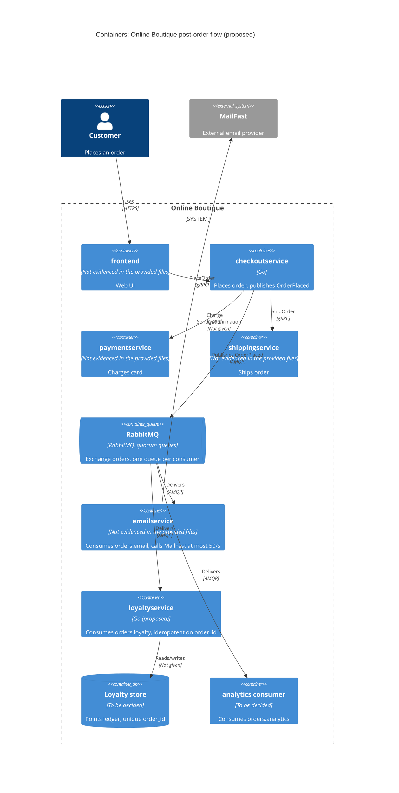

> Agent: Claude Code (VS Code extension) / Model: Claude Opus 5.5 (`claude-opus-5-5`)

# ADR-0002: Publish an "OrderPlaced" event to RabbitMQ for post-order actions

- **Status:** Proposed
- **Date:** 2026-10-22
- **Deciders:** ทีมพัฒนา Online Boutique (4 developers) ร่วมกับทีม marketing (ยังไม่ได้ระบุชื่อผู้ตัดสินใจ ดู Open questions)

## Context and problem

Requirement R-12 (`docs/scenario.md`) กำหนดว่าหลังจากสั่งซื้อสำเร็จ ระบบต้อง (1) ส่งอีเมลยืนยันผ่าน **MailFast** แทน logic จำลองใน `emailservice` (2) ให้ loyalty points ผ่าน `loyaltyservice` ที่จะสร้างใหม่ และ (3) บันทึก analytics event "order placed" ให้ทีม marketing นอกจากนี้ marketing ยังคาดว่าปีหน้าจะมี post-order action เพิ่มอีก ได้แก่ SMS, fraud scoring และ recommendations update

**สิ่งที่โค้ดปัจจุบันแสดงให้เห็น**

| ข้อเท็จจริง | หลักฐาน |
|---|---|
| `PlaceOrder` ทำงานตามลำดับแบบ synchronous คือ `chargeCard` แล้ว `shipOrder` แล้ว `emptyUserCart` แล้ว `sendOrderConfirmation` | `system/online-boutique/src/checkoutservice/main.go` (`PlaceOrder`, บรรทัด 252–277) |
| การส่งอีเมลเรียก `emailservice` ผ่าน gRPC โดยใช้ `ctx` ของ request เดียวกัน ดังนั้น latency ของอีเมลจึงถูกนับรวมใน latency ของ `PlaceOrder` | `main.go` (`sendOrderConfirmation`, บรรทัด 379–384 และบรรทัด 273) |
| ถ้าส่งอีเมลไม่สำเร็จ ระบบแค่ log warning และ order ยังสำเร็จ | `main.go` บรรทัด 273–277 |
| `checkoutService` มีแค่ gRPC connection ไปยัง 6 services และไม่มี database หรือ message broker ของตัวเอง | `main.go` (`type checkoutService`, บรรทัด 66–86; `mustMapEnv` บรรทัด 111–116) |
| ทุก downstream address มาจาก environment variable และใช้ `insecure.NewCredentials()` | `main.go` (`mustConnGRPC`, บรรทัด 210–220) |

**ตัวเลขที่ทำให้ปัญหานี้ยาก** (จาก `docs/scenario.md`)

- p95 ของ `PlaceOrder` ต้องอยู่ที่ **≤ 500 ms** ซึ่งตอนนี้อยู่ที่ประมาณ 300 ms จึงเหลือ budget ราว 200 ms
- MailFast มี p95 **1.5 s** และ p99 **8 s** ล้มเหลวประมาณ **0.5 %** และจำกัดอัตราที่ **50 emails/s**
- peak load ช่วง 11.11 อยู่ที่ **200 orders/s** ซึ่งสูงกว่า rate limit ของ MailFast ถึง 4 เท่า
- loyalty points ต้องได้ **ภายใน 1 นาที** และ **exactly once**
- order ต้อง **ไม่ล้มเหลว** เพราะ email, loyalty หรือ analytics ล่ม

ผลที่ตามมาจากตัวเลขเหล่านี้คือ ถ้าเรียก MailFast แบบ synchronous ใน `PlaceOrder` ค่า p95 จะเกิน 500 ms ทันที (300 ms + 1.5 s) และเมื่อถึง peak คำขอส่วนเกิน 150 emails/s (200 − 50) จะชน rate limit ดังนั้นปัญหาที่ต้องตัดสินใจคือ **checkoutservice ควรส่งต่องานหลังสั่งซื้อไปยังผู้รับหลายรายอย่างไร** ให้ checkout ยังเร็ว ไม่ล้มตามระบบปลายทาง และเพิ่ม action ใหม่ได้ง่าย

## Decision drivers

1. **Availability:** order ต้องไม่ล้มเหลวเพราะ email, loyalty หรือ analytics ล่ม
2. **Performance (latency):** p95 ของ `PlaceOrder` ต้อง ≤ 500 ms ที่ 200 orders/s
3. **Correctness ของ loyalty:** ต้องได้ points ภายใน 1 นาที และไม่ซ้ำ (exactly once)
4. **การเคารพข้อจำกัดของ MailFast:** ต้องไม่ส่งเกิน 50 emails/s และต้องรับมือกับ latency หาง (p99 8 s) และความล้มเหลว 0.5 % ได้
5. **Modifiability:** ปีหน้าต้องเพิ่ม SMS, fraud scoring และ recommendations update ได้โดยแก้ `checkoutservice` ให้น้อยที่สุด
6. **ข้อจำกัดด้านทีมและ operations:** ทีมมี 4 คน เก่ง Go/gRPC และมี 2 คนเคยใช้ RabbitMQ อีกทั้งทุกอย่างรันบน Kubernetes และบริษัทชอบ component แบบ open-source ที่ self-host ได้

## Considered options

1. **ขยาย synchronous orchestration เดิม:** ให้ `PlaceOrder` เรียก MailFast, `loyaltyservice` และ analytics ต่อกันแบบ synchronous (gRPC/HTTPS)
2. **In-process async ใน checkoutservice:** ตอบ client ก่อน แล้วค่อยเรียกปลายทางทั้งสามใน goroutine พร้อม retry ใน memory
3. **Publish domain event `OrderPlaced` ไปยัง RabbitMQ (self-hosted บน Kubernetes):** ใช้ exchange แบบ fan-out ให้แต่ละ consumer มี queue ของตัวเอง
4. **Publish event ไปยัง Apache Kafka (self-hosted บน Kubernetes):** ใช้ topic `orders.placed` ให้แต่ละ consumer group อ่านแยกกัน

### Pros and cons of the options

| Option | Pros | Cons |
|---|---|---|
| 1. Sync orchestration | ง่ายที่สุดและไม่มี infrastructure ใหม่; ผลลัพธ์รู้ทันทีและ trace ตามลำดับได้ง่าย | p95 เกิน 500 ms แน่นอนเพราะ MailFast p95 อยู่ที่ 1.5 s; ที่ 200 orders/s จะชน rate limit 50/s; ถ้าทำให้ล้มเหลวแบบ soft แล้ว loyalty ที่ fail ก็จะหายไป ทำให้ผิดข้อกำหนด "ภายใน 1 นาที"; ทุก action ใหม่ต้องแก้ `PlaceOrder` (coupling สูง) |
| 2. In-process async (goroutine) | ไม่เพิ่ม latency ให้ checkout; ไม่มี component ใหม่; ทีมคุ้นกับ Go อยู่แล้ว | งานที่ค้างอยู่หายเมื่อ pod restart หรือ scale down ซึ่งผิดข้อกำหนด loyalty; ควบคุม rate 50/s ข้าม replica หลายตัวได้ยาก; backlog ช่วง peak กิน memory ของ checkout; ทุก action ใหม่ยังต้องแก้ `checkoutservice` |
| 3. RabbitMQ event | checkout แค่ publish แล้วตอบกลับ จึงตัด latency ของ MailFast ออกจาก critical path; queue เก็บ backlog ช่วง peak ไว้ให้ consumer ดึงตาม rate ที่กำหนดได้; มี ack/redelivery และ dead-letter queue รองรับ retry; การเพิ่ม action ใหม่ทำได้ด้วยการ bind queue ใหม่เข้ากับ exchange โดยไม่ต้องแก้ checkout; open-source, self-host บน Kubernetes ได้; ทีม 2 คนเคยใช้แล้ว | เพิ่ม stateful component ที่ต้อง operate (HA, monitoring, upgrade); delivery เป็นแบบ at-least-once จึงต้องทำ idempotency ฝั่ง consumer เอง; broker กลายเป็น dependency ใหม่ของ checkout ตอน publish; debug และ trace แบบ async ยากขึ้น; เกิด eventual consistency |
| 4. Kafka event | throughput สูงและเก็บ log ไว้ replay ได้ ซึ่งเหมาะกับ analytics และ consumer ใหม่ที่ต้องการข้อมูลย้อนหลัง; open-source, self-host ได้ | operate ยากกว่า RabbitMQ (partition, retention, cluster); ไม่มีหลักฐานว่าทีมเคยใช้; การ rate limit และ retry ทีละข้อความ (เช่น MailFast 0.5 % fail) ต้องสร้าง retry topic และ DLQ เอง; ปริมาณ 200 events/s ไม่จำเป็นต้องใช้ความสามารถระดับ Kafka **[Inferred]**; ยังต้องทำ idempotency ฝั่ง consumer เช่นกัน |

## Decision

เลือก **Option 3: publish domain event `OrderPlaced` ไปยัง RabbitMQ** เพราะเป็นทางเดียวในชุดตัวเลือกที่ตอบ driver 1–5 ได้พร้อมกัน และยังเข้ากับทักษะของทีมและนโยบาย self-hosted (driver 6) มากกว่า Kafka

**รายละเอียดของการตัดสินใจ**

1. **checkoutservice:** หลังจาก `shipOrder` สำเร็จ ให้แทนที่การเรียก `sendOrderConfirmation` แบบ synchronous (`main.go` บรรทัด 273) ด้วยการ publish `OrderPlaced` ไปยัง exchange `orders` (fan-out) โดยใช้ `order_id` เป็น message ID และเปิด publisher confirms พร้อม timeout สั้นๆ ที่อยู่ใน budget 200 ms ถ้า publish ไม่สำเร็จ order ยังต้องสำเร็จ (ตาม driver 1) แต่ให้ log ระดับ error พร้อม `order_id` (ไม่ใส่อีเมลลูกค้า) และนับ metric เพื่อให้ตามไปแก้ไขภายหลังได้ (ดู Risks)
2. **`emailservice`:** เปลี่ยนเป็น consumer ของ queue `orders.email` ที่เรียก MailFast โดยต้องมี rate limiter แบบรวมทุก replica ไม่ให้เกิน 50 emails/s (เช่น ใช้ replica เดียวพร้อม token bucket) ใช้ retry แบบ exponential backoff และส่งไป dead-letter queue เมื่อ retry ครบจำนวนครั้ง ทั้งนี้ concurrency ต้องรองรับ request ที่ค้างอยู่ได้ราว 50/s × 1.5 s ≈ 75 รายการที่ p95 และอาจถึง 50/s × 8 s ≈ 400 รายการที่ p99 (คำนวณจากตัวเลขใน scenario ด้วย Little's law)
3. **`loyaltyservice` (ใหม่):** เป็น consumer ของ queue `orders.loyalty` ที่แยกจากอีเมล เพื่อไม่ให้ backlog ของ MailFast มาหน่วง loyalty วิธีให้ได้ผลแบบ exactly once คือทำ idempotent consumer: บันทึก points พร้อม unique constraint บน `order_id` ใน transaction เดียวกัน แล้วค่อย ack ข้อความ ดังนั้นข้อความที่ถูก redeliver จะไม่ทำให้ได้ points ซ้ำ
4. **Analytics:** สร้าง consumer ของ queue `orders.analytics` ที่บันทึก event ให้ทีม marketing ส่วนปลายทางที่จะเก็บข้อมูลยังไม่ได้ระบุ (ดู Open questions)
5. **Action ในอนาคต** (SMS, fraud scoring, recommendations) ให้แต่ละตัวสร้าง queue ใหม่แล้ว bind เข้ากับ exchange `orders` โดยไม่ต้องแก้ `checkoutservice`
6. **RabbitMQ:** deploy บน Kubernetes เป็น cluster 3 nodes และใช้ quorum queues ที่เป็น durable

หมายเหตุ: `frontend` ในรูปและภาษาของ service อื่นนอกเหนือจาก `checkoutservice` ไม่ได้มาจากไฟล์ใน context ของงานนี้ จึงระบุว่า "Not evidenced in the provided files" ส่วน `frontend` ใส่ไว้เพื่อให้เห็นจุดเริ่มต้นของ flow **[Inferred]**

## Consequences

- **Positive:** latency ของ MailFast (p95 1.5 s, p99 8 s) ออกไปจาก critical path ของ `PlaceOrder` ทำให้ checkout เพิ่มแค่เวลา publish พร้อม confirm ซึ่งคาดว่าน้อยกว่า budget 200 ms มาก **[Inferred, ต้องวัดจริง]** (quality attribute: performance)
- **Positive:** เมื่อ MailFast, `loyaltyservice` หรือ analytics ล่ม ข้อความจะค้างอยู่ใน queue แทนที่ order จะล้มเหลว และจะถูกประมวลผลเมื่อปลายทางกลับมา (quality attribute: availability, fault isolation)
- **Positive:** queue ช่วยดูดซับส่วนต่างระหว่าง 200 orders/s กับ 50 emails/s ทำให้ไม่ละเมิด rate limit ของ MailFast (quality attribute: scalability, interoperability)
- **Positive:** action ใหม่ในปีหน้าเพิ่มได้ด้วย queue และ consumer ใหม่ โดยไม่ต้องแก้หรือ redeploy `checkoutservice` (quality attribute: modifiability, extensibility)
- **Negative:** อีเมลยืนยันจะถึงลูกค้าช้าลงในช่วง peak โดยจากตัวเลขใน scenario backlog จะเพิ่มขึ้น 150 ฉบับ/s หรือ 9,000 ฉบับต่อทุกนาทีที่อยู่ใน peak และเมื่อไม่มี order ใหม่เข้ามาเลย ต้องใช้เวลาอีก 180 s ต่อ backlog 1 นาทีกว่าจะส่งหมด (quality attribute: performance จากมุมมองลูกค้า / timeliness)
- **Negative:** มี stateful component ใหม่ที่ทีม 4 คนต้องดูแล ทั้ง HA, upgrade, monitoring queue depth และ DLQ (quality attribute: operability, cost)
- **Negative:** consistency เป็นแบบ eventual และ delivery เป็นแบบ at-least-once จึงต้องเขียน idempotency ในทุก consumer และ trace flow ข้าม async boundary ได้ยากขึ้น (quality attribute: testability, maintainability)
- **Risks and mitigations:**
  - **Broker ล่มหรือ publish ไม่สำเร็จหลังจากตัดเงินแล้ว:** order ยังสำเร็จ แต่ event อาจหายไป ซึ่งจะทำให้ลูกค้าไม่ได้ loyalty points (ผิดข้อกำหนด) ทางลดความเสี่ยงคือใช้ RabbitMQ cluster 3 nodes กับ quorum queues, publish พร้อม retry ภายใน timeout และ log `order_id` ที่ publish ไม่ได้เพื่อให้ reconciliation job ส่งซ้ำ ส่วนทางที่แข็งแรงกว่าคือ transactional outbox แต่ทำไม่ได้ทันที เพราะ `checkoutservice` ไม่มี database (`main.go` บรรทัด 66–86) (ดู Open questions)
  - **อีเมลซ้ำ:** การ redeliver แบบ at-least-once อาจทำให้ลูกค้าได้อีเมลซ้ำ ทางลดความเสี่ยงคือส่ง `order_id` เป็น idempotency key ถ้า MailFast รองรับ หรือเก็บรายการ `order_id` ที่ส่งแล้วฝั่ง `emailservice`
  - **Loyalty เกิน 1 นาทีช่วง peak:** ถ้า `loyaltyservice` ประมวลผลไม่ทัน 200 events/s ข้อกำหนดจะถูกละเมิด ทางลดความเสี่ยงคือแยก queue จากอีเมล, scale consumer ตาม queue depth และตั้ง alert เมื่อ message age เกิน 30 s
  - **ข้อความที่ล้มเหลวถาวร:** ส่งเข้า DLQ แล้วตั้ง alert ให้คนตรวจ เพื่อไม่ให้ retry วนไม่จบจนกิน rate limit ของ MailFast
  - **Security / ข้อมูลส่วนบุคคล:** event มีอีเมลลูกค้า ซึ่งเป็น personal data ดังนั้นควรเปิด TLS และ authentication บน RabbitMQ (โค้ดปัจจุบันใช้ `insecure.NewCredentials()` สำหรับ gRPC ตาม `main.go` บรรทัด 215 จึงไม่ควรใช้แนวทางเดียวกันกับ broker), จำกัด permission ของแต่ละ consumer ให้อ่านเฉพาะ queue ของตัวเอง, ไม่ส่งอีเมลลูกค้าไปยัง analytics ถ้าไม่จำเป็น, เก็บ API key ของ MailFast ใน Kubernetes Secret และห้าม hard-code และควรเลิก log อีเมลลูกค้าแบบเต็มอย่างที่ทำอยู่ใน `main.go` บรรทัด 274 และ 276

## Validation

- **Load test** ด้วย `loadgenerator` (Locust ตามที่ ADR-0001 อ้างถึง) ที่ 200 orders/s แล้วตรวจว่า p95 ของ `PlaceOrder` ≤ 500 ms
- **Loyalty timeliness:** วัดเวลาจาก publish จนถึงการบันทึก points ในช่วง load test และต้องให้ max (หรืออย่างน้อย p99.9) < 60 s
- **Exactly once:** ทดสอบโดย redeliver ข้อความเดิมซ้ำและ kill consumer ก่อน ack แล้วตรวจว่า points ต่อ `order_id` ถูกบันทึกเพียงครั้งเดียว
- **Rate limit:** ใช้ MailFast mock ที่มี latency และ error ตาม scenario (p95 1.5 s, p99 8 s, 0.5 % fail) แล้วตรวจว่าอัตราการส่งไม่เกิน 50/s และไม่มีข้อความหาย นอกจากข้อความที่อยู่ใน DLQ
- **Failure injection:** ปิด `emailservice`, `loyaltyservice`, analytics consumer และ MailFast ทีละตัว แล้วตรวจว่าทุก order ยังสำเร็จ
- **Metrics ใน production:** queue depth, message age, DLQ size, publish failures และ duplicate detections
- **Review date:** ทบทวน ADR นี้หลังจากผ่าน 11.11 sale ครั้งแรกที่ใช้ระบบนี้ (ยังไม่มีวันที่ใน context)

## Open questions

1. **ความล่าช้าที่ยอมรับได้ของอีเมลยืนยัน** ไม่ได้ระบุไว้ และ backlog ช่วง peak ขึ้นกับว่า 11.11 peak ที่ 200 orders/s กินเวลานานเท่าไร ซึ่งก็ไม่ได้ระบุเช่นกัน
2. **MailFast มี quota ที่ยกระดับได้หรือไม่** และรองรับ idempotency key หรือไม่ รวมถึงใช้ protocol อะไร (REST/HTTPS, SMTP ฯลฯ)
3. **ถ้า publish event ไม่สำเร็จ ยอมรับให้ loyalty points หายได้ไหม** หรือต้องมี durable outbox ซึ่งหมายถึงต้องเพิ่ม database ให้ `checkoutservice` (ปัจจุบันไม่มี)
4. **Order ID ในปัจจุบันสร้างจาก `uuid.NewUUID()`** (`main.go` บรรทัด 233) โดยไม่มีระบบที่เก็บ order ไว้ แล้วจะใช้อะไรเป็นแหล่งข้อมูลจริงสำหรับ reconciliation
5. **Data store ของ `loyaltyservice`** และภาษาที่จะใช้ยังไม่ได้ตัดสินใจ (เสนอ Go ตามทักษะของทีม) ควรแยกเป็น ADR ใหม่
6. **ปลายทางของ analytics event** (warehouse, tool ของ marketing) และ schema ที่ marketing ต้องการ รวมถึงว่าต้องใช้ข้อมูลส่วนบุคคลหรือไม่
7. **นโยบาย retention / PDPA** สำหรับข้อมูลลูกค้าที่อยู่ใน queue และ DLQ
8. **ทรัพยากร Kubernetes และงบประมาณ** สำหรับ RabbitMQ cluster 3 nodes ไม่ได้ระบุ
9. **รายชื่อ Deciders** และวันที่ review ที่แน่นอน
10. **ภาษาและ protocol ของ `paymentservice`, `shippingservice` และ `emailservice`** ไม่มีหลักฐานในไฟล์ที่ได้รับอนุญาตให้อ่าน แต่ไม่มีผลต่อการตัดสินใจนี้
